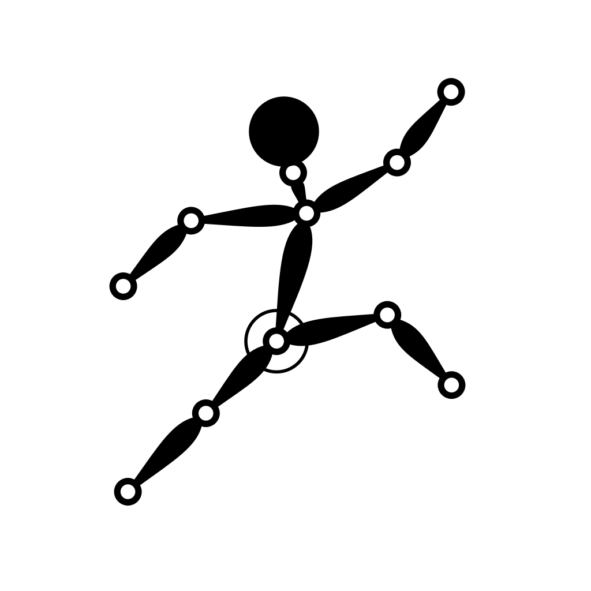
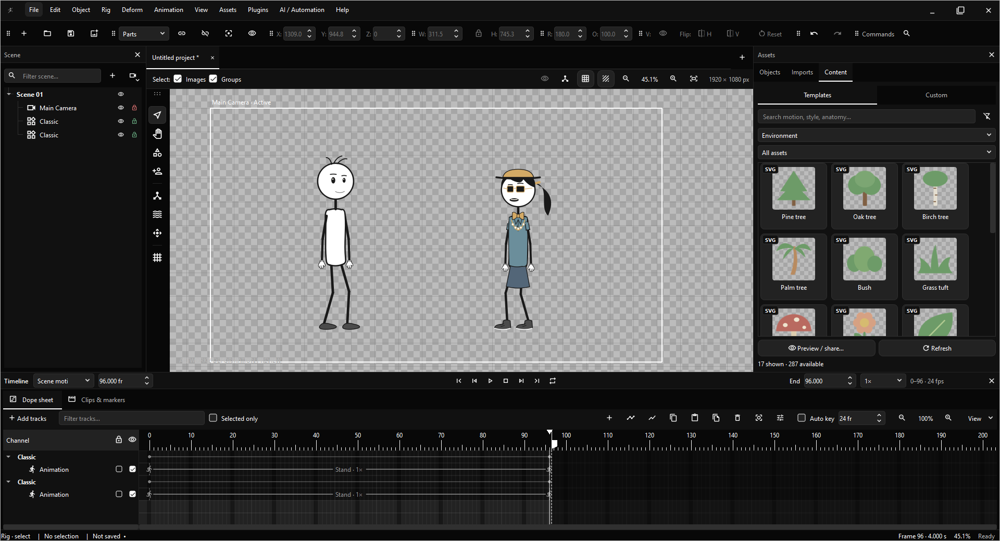
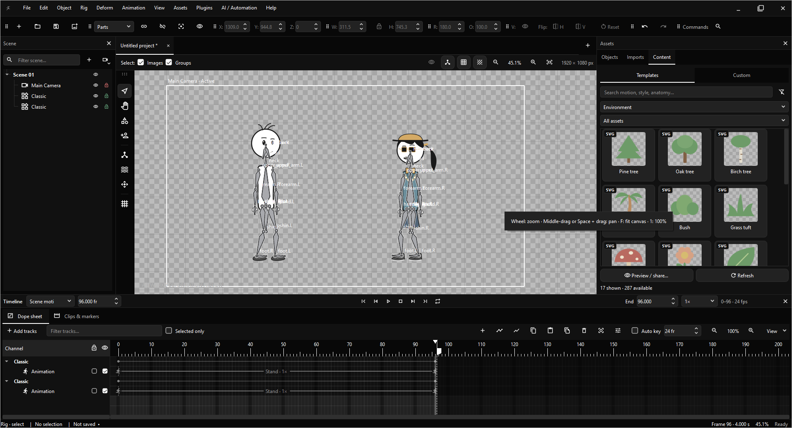

<h1 align="center">
  
  Rigora 2D
</h1>

<p align="center">Version <strong>1.0.0</strong> · Development candidate</p>

<p align="center">
  
  
</p>

Rigora is a desktop rigging and animation editor for 2D games and character animation. Build a character from replaceable vector parts, pose its rig, author reusable motion, and export artwork or an editable game rig.

The editor, Python API, command-line tools, and MCP integration use the same animation services. Local workflows run offline after dependencies are installed.

## Getting started

### Download a compiled version

Open this repository's **Releases** page and choose a package for your operating system. Extract the complete archive and launch Rigora. Keep its assets, plugins, and runtime folders beside the application.

Windows x64 is the primary development platform. The release workflow also targets Linux x64 and Apple Silicon macOS; see [platform requirements](docs/desktop-builds.md).

### Run from source

Install [Python 3.12](https://www.python.org/downloads/) and [uv](https://docs.astral.sh/uv/getting-started/installation/), then run these commands in the project folder:

```sh
uv sync --locked --extra gui
uv run --no-sync rigora
```

On Windows, use `Run_Rigora.bat` after setup. For every optional import, output, tracking, and automation integration, use `uv sync --locked --all-extras` on a supported platform. See [installation](docs/installation.md) for choosing individual extras.

## Features

- **SVG Character Creation:** Customize simple and hand-drawn stick figures with visual part grids, retained alternatives, complete outfit sets, independent colors and layered accessories. Preview 15 eye styles, nine compatible lip-sync mouth sets and 19 editable source actions, including seven run styles on an isolated stage with camera framing, zoom and background controls.
- **Reusable Objects:** Share artwork, rigs, clothing, and Object Editor changes across linked placements. Each placement keeps its own scene transform, visibility, and opacity. Object Views and private actions keep character work separate from scene arrangement.
- **Skeletal animation:** Pose connected rigs with Bone, Chain FK, Rig, and IK selection modes. Edit joint limits, parent relationships, bindings, constraints, and pivots with evaluated geometry visible during a gesture.
- **Scene attachments:** Connect props to placed characters or other Objects through named grips. Keep position or snap to a hand, adjust offsets, and key pickups, transfers and releases on a flat Attachment timeline row. Complete rigs retain their skinning, springs and source animation. See [Scene attachments](docs/scene-attachments.md).
- **Skinning and vector deformation:** Edit mesh topology and weights, bind artwork to bones, and animate FFD, lattices, sculpting, pins, masks, and ordered deformation stages. SVG deformation renders from original vectors at the output resolution.
- **Timeline and curves:** Arrange named character animations directly in the dope sheet with editable speed and looping. Palette and clothing keys switch saved appearances on separate flat rows. Grouped Transform channels, scalar graphs, Bezier handles, reusable clips, retiming, reversal, blends, transitions, and root offsets share the same evaluator. Onion poses, trails, and retained-frame comparisons help inspect motion.
- **Layered motion and contacts:** Combine masked Override/Additive actions with weight, live crossfades and per-character Mute/Solo. Author planted-foot intervals and editable IK anchors, then bake a separate FK action. Parameter-driven state machines preview existing actions without rewriting them.
- **Spring Dynamics and Motion Pilot:** Apply spring groups, per-chain controls, pins, and local motion recording. Preview physics, key activation, and bake results into editable animation channels.
- **Motion retargeting:** Map semantic bones between compatible rigs and transfer reusable poses and actions while inspecting the resulting motion.
- **Creative Templates:** Drag editable skeletons, 85 skeletal motions, 26 FFD motions/shapes and 20 spring profiles onto compatible artwork or rigs. Original SVG props, geometric shapes and 25 layered animated Objects include fire, water, weather and moving mechanisms. PNG card previews are generated into a disposable local cache; see [Creative Templates](docs/creative-templates.md).
- **Facial animation and lip-sync:** Coordinate eyes, brows, mouths, expressions, and visemes. Built-in offline phoneme recognition analyzes recordings and previews live speech without an external executable. Audition voice and mouth timing independently of the scene, then retain editable mouth keys and synchronized audio. Visual cue editing and audio-reactive gestures support refinement.
- **Local performance capture:** Optional MediaPipe integration drives face and body controls, with calibrated head turns selecting authored Object views. Movement-driven view mappings share the scene evaluator and yield to explicit View keys. Task models are supplied locally; see the [camera performance guide](docs/camera-performance.md).
- **Media to editable rigs:** Recover human and quadruped poses from images, image sequences and video with local RTMLib, RTMPose and ViTPose models. Review exact joint corrections with length guards, zoom, anatomical labels and a previous-pose overlay. Create a posed rig or editable motion, with optional artwork from source alpha or built-in background keying; see [Media to Rig](docs/video-to-rig.md).
- **Animated scene cameras:** Arrange multiple cameras with shared Transform, Cut, Animation and Effect rows. Combine 14 camera motion presets and 15 lens overlays with authored keys, editable timing, speed and strength. Camera cuts, color/image backgrounds and overlays carry through preview and rendered output. The workspace remains editable outside the camera frame.
- **Shot planning and vector paths:** Arrange camera shots with worker-generated thumbnails, composition guides, target following and editable shot transitions. Author cubic SVG artwork and Object/camera motion paths with draggable anchors and handles.
- **Game data and particles:** Author typed animation events, animated hit/hurt regions and seeded World/Local vector particles. World-space particles support deterministic ground collision, bounce/friction and attract/repel magnets. Region collision/damage policy remains under game-code control.
- **Puppet Stage and local output:** Trigger editable action/replay cards, record voice with a performance, and retain synchronized audio rate/loop controls. Publish transparent camera frames through an explicit local browser source for broadcast software, including scratch performances.
- **Production controls:** Recover unsaved checkpoints, restore saved tabs, replace source artwork with binding-preserving Undo, and mix independently trimmed/faded audio tracks. Background project I/O, chunked larger-project storage, measured performance diagnostics and preview quality controls support heavier scenes.
- **Layered media import:** Import raster images, SVG, image sequences, sprite sheets, OpenRaster, basic layered PSD, and PDF-compatible Illustrator artboards. Illustrator import uses an explicit raster approximation; SVG remains the vector workflow.
- **Render and game exports:** Export transparent PNG/SVG sequences, streamed GIF, APNG/WebP, sprite atlases, runtime JSON, and H.264 or alpha video through local FFmpeg. Check samples, sources and adapter capabilities before export. Godot native 2D and Unity editable rigs support bones, clothing, animated textures, camera cuts/overlays and particles. Planar Godot and Unreal routes have separate limits; see [format support](docs/game-engine-export.md).
- **Integrated plugins:** Add menus, toolbars, viewport tools, editor buttons, docks, inspectors, hooks, engine solvers, track samplers, character presets, and content packs through Extension API 2. Plugins use the same services and Undo history as built-in tools.
- **Automation:** Use the Python API, CLI, or optional local MCP server for project editing, rigging, animation, and export. Transactions and file-access controls are shared across these interfaces.

Read the [known limitations](docs/limitations.md) for incomplete integrations and current constraints. Rigora is still under active development.

## Plugins

The [plugin development tutorial](docs/plugin-development.md) walks through creating a package, adding actions and a panel, testing Undo and project changes, and distributing a ZIP. The [API reference](docs/plugin-sdk.md) covers callback contracts, permissions, dependencies, and lifecycle behavior.

Working examples include [Studio Tools](plugins/studio_tools/README.md), [Rig Health Check](plugins/rig_health/README.md), and the [SDK examples](examples/plugins/README.md). Installed Python plugins run as trusted code and start disabled until reviewed and enabled.

## Documentation

Start with the [documentation index](docs/README.md). Workflow guides cover [character creation](docs/character-wizard.md), [rigging](docs/rigging-guide.md), [animation](docs/animation-editing.md), [spring dynamics](docs/spring-and-motion-pilot.md), and [engine exports](docs/game-engine-export.md).

The [production workflow guide](docs/production-workflows.md) covers recovery, contacts, layers, audio, game data, shot planning and state-machine preview, with current bounds and engine differences.

Developer references include [architecture](docs/architecture/0001-foundation.md), [Python API](docs/python-api.md), [CLI](docs/cli-reference.md), [MCP setup](docs/mcp-setup.md), [project format](docs/project-format.md), and [contributing](docs/contributing.md).

## Development and releases

Rigora uses Python 3.12 and PySide6 with MVVM. Domain and engine modules have no Qt dependency. Canonical artwork, fonts, and icons live in `assets/`.

```sh
uv sync --locked --extra gui
uv run --no-sync ruff check .
uv run --no-sync ruff format --check .
uv run --no-sync mypy
```

On Windows, `Test_Rigora.bat --no-pause` runs the source checks. GUI tests use an offscreen Qt platform. See [development](docs/development.md) for the individual commands.

Native compilation is separate: `Build_Rigora.bat` on Windows or `bash Build_Rigora.sh` on Linux/macOS. These compile by default; application testing requires `--verify`.

The manual **Build and upload to latest release** GitHub Action compiles native packages, creates ZIP archives, and attaches them to the selected published release. It builds the release tag's commit and records package hashes. See [GitHub releases](docs/github-releases.md) for setup, reruns, and supported targets.

## Licensing and credits

The project has not selected a top-level source license. Original CC0 assets and examples, bundled Material Icons notices, and owner-supplied artwork retain their individual terms. See [provenance](docs/provenance.md) before redistribution.
